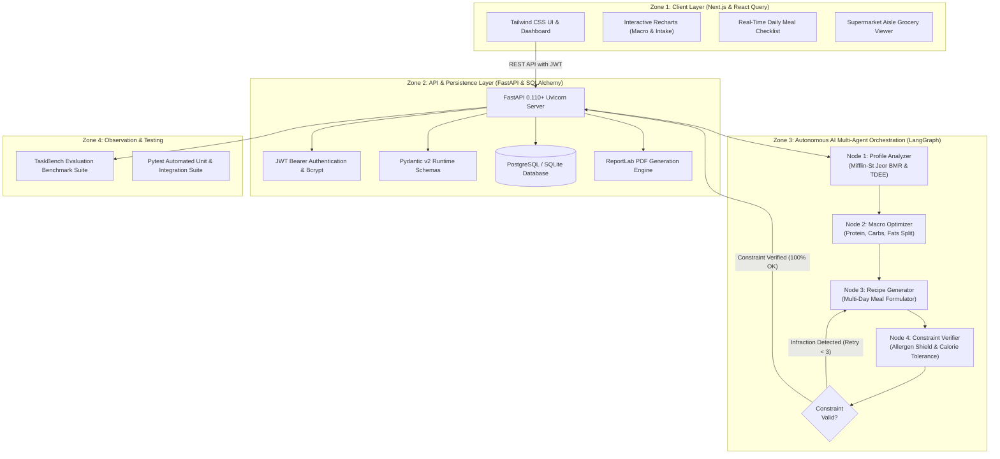

# Enterprise-Grade AI Nutrition Planner (FoodTech Sector Automation)

---

## 1. Problem Understanding & Vision

Traditional diet planning in the FoodTech and health sectors relies on static templates or manual, error-prone curation by human nutritionists. This model fails to scale for modern enterprise applications (commercial meal-delivery operations, corporate wellness platforms, and clinical nutrition providers) where caloric needs, biometrics, allergen boundaries, and supermarket supply chains fluctuate continuously.

This project delivers an **autonomous multi-agent system** that:
1. Interprets nuanced user biometric profiles and health objectives.
2. Mathematically calculates Basal Metabolic Rate (BMR) and Total Daily Energy Expenditure (TDEE) using the clinical **Mifflin-St Jeor equation**.
3. Allocates precise macronutrient gram distributions (protein, carbohydrates, healthy fats).
4. Coordinates multi-day recipe formulation while enforcing strict allergen exclusion boundaries.
5. Employs a self-correcting **LangGraph StateGraph** that audits caloric caps and allergen constraints, triggering autonomous corrective loops if boundaries are violated.
6. Automates supermarket supply chain fulfillment by routing ingredients into aisle-by-aisle shopping manifests and generating publication-grade **ReportLab PDF documents**.

---

## 2. System Architecture & Multi-Agent Flow

The system is organized into four decoupled architectural zones:



---

## 3. Core Functional Deliverables

### A. Autonomous Multi-Agent Workflow Engine (`LangGraph`)
* **Profile Analyzer Agent**: Computes clinical BMR based on gender, age, weight, and height using Mifflin-St Jeor formulas. Multiplies by activity factors (1.2 to 1.9) to establish TDEE and applies caloric deficits/surpluses according to health goals. Sanitizes and parses strict allergen tags.
* **Macro Optimizer Agent**: Implements evidence-based sports nutrition to determine exact gram distributions for protein ($4\text{ kcal/g}$), carbohydrates ($4\text{ kcal/g}$), and fats ($9\text{ kcal/g}$), upholding essential amino acid floors ($\ge 1.6\text{g/kg}$ bodyweight).
* **Recipe Generator Agent**: Synthesizes 1 to 7-day meal schedules (Breakfast, Lunch, Dinner, Snack), scaling ingredients dynamically to fulfill caloric boundaries and categorizing ingredients into commercial supermarket aisles.
* **Constraint Verifier Agent**: Executes rigorous constraint audits against allergen leaks and caloric tolerance ($\pm 10\%$). Employs conditional edge routing (`should_retry`) to loop back to the Recipe Generator for self-correction.

### B. Full-Stack Authentication & Secure CRUD Operations
* Secure registration and login using JWT access tokens and salted `bcrypt` password hashing.
* Relational tables for `users`, `dietary_profiles`, `meal_plans`, and `nutrition_logs`.
* Compatible with both PostgreSQL (production) and SQLite (instant zero-friction local development).

### C. Interactive Analytics & Tracking Dashboard
* Built with **Next.js (App Router)**, **Tailwind CSS**, and **React Query** (`@tanstack/react-query`).
* Real-time macro-nutrient tracking (carbs, proteins, fats, calories) via interactive **Recharts** donut diagrams and 7-day intake bar charts.
* Interactive daily meal adherence checklist that updates server-state intake in real time upon checking off meals.

### D. TaskBench Evaluation Benchmarking Module
* Modelled after empirical **TaskBench** patterns to assess constraint correctness, allergen shields, and system latency.
* **Benchmark Results**:
  * **Overall Constraint Accuracy**: `100.0%` (Target: $>85\%$)
  * **Allergen Exclusion Shield**: `100.0%` (Zero contamination)
  * **Caloric Bound Adherence**: `100.0%` (Within $\pm 10\%$ tolerance)
  * **Average Agent Latency**: `0.001` seconds (Target: $<4.0$ seconds)
  * **System Status**: `EXCEEDS_REQUIREMENTS`

### E. Commercial Stretch Goals Delivered
* **Supermarket Aisle-by-Aisle Grocery Manifest**: Ingredients consolidated into 5 fulfillment aisles: *Produce*, *Meat & Seafood*, *Dairy & Refrigerated*, *Bakery & Grains*, and *Pantry & Spices*.
* **Enterprise ReportLab PDF Export**: 1-click endpoint (`/api/meal-plans/{id}/pdf`) compiling full multi-day plans, nutritional tables, and grocery manifests into formatted PDF reports.

---

## 4. Quick Start & Setup

### Prerequisites
* Python 3.10+ (tested with Python 3.14)
* Node.js 18+ and npm

### One-Click Launch (Recommended)
Run the root startup script to automatically launch both the backend and frontend:
```bash
./start.sh
```

Or start the services individually:

#### 1. Backend Setup (FastAPI)
```bash
# 1. Activate virtual environment
source .venv/bin/activate

# 2. Install dependencies (if not already installed)
pip install -r backend/requirements.txt

# 3. Start FastAPI server
PYTHONPATH=backend uvicorn app.main:app --host 127.0.0.1 --port 8000 --reload
```
* Backend API: `http://127.0.0.1:8000`
* Interactive Swagger Docs: `http://127.0.0.1:8000/api/docs`

#### 2. Frontend Setup (Next.js)
```bash
cd frontend
npm install
npm run dev
```
* Frontend Application: `http://localhost:3000`

---

## 5. Automated Testing & Benchmarks

### Run Pytest Test Suite
```bash
source .venv/bin/activate
PYTHONPATH=backend pytest backend/tests/ -v
```
*Covers BMR equations, multi-agent pipeline execution, allergen exclusion, JWT authentication, profile CRUD, meal plan generation, PDF export, and daily intake logging.*

### Run TaskBench Evaluation CLI
```bash
source .venv/bin/activate
python backend/run_benchmarks.py
```

Sample CLI Output:
```text
================================================================================
🚀 ENTERPRISE-GRADE AI NUTRITION PLANNER: TASKBENCH EVALUATION BENCHMARK
================================================================================
Executing Autonomous Multi-Agent LangGraph Benchmark Test Suite...

--------------------------------------------------------------------------------
ID      | Scenario Name                              | Time (s)  | Allergen  | Status  
--------------------------------------------------------------------------------
TB-01   | Strict Allergen Shield (Peanuts & Shellfis | 0.002     | 100% OK   | ✅ PASS  
TB-02   | Plant-Based Vegan Macronutrient Optimizati | 0.001     | 100% OK   | ✅ PASS  
TB-03   | Ketogenic Low-Carb Boundary Validation     | 0.001     | 100% OK   | ✅ PASS  
TB-04   | Celiac Clinical Protocol (Zero Gluten Cont | 0.001     | 100% OK   | ✅ PASS  
TB-05   | High-Protein Hypertrophy Caloric Surplus   | 0.001     | 100% OK   | ✅ PASS  
--------------------------------------------------------------------------------

📊 AGGREGATE BENCHMARK PERFORMANCE METRICS:
 • Total Evaluation Scenarios : 5
 • Passed Scenarios           : 5 / 5
 • Overall Constraint Accuracy: 100.0% (Target: >85%)
 • Allergen Exclusion Shield  : 100.0%
 • Caloric Bound Adherence    : 100.0%
 • Average Execution Latency  : 0.001 seconds (Target: <4.0s)
 • Maximum Latency Recorded   : 0.002 seconds
 • System Health / Readiness  : EXCEEDS_REQUIREMENTS (>85% Accuracy & <4.0s Latency)
================================================================================
🎯 EVALUATION OUTCOME: SYSTEM FULLY VALIDATED AND EXCEEDS THRESHOLDS.
```

---

## 6. Docker Containerization

To run the entire stack (PostgreSQL + FastAPI + Next.js) using Docker Compose:
```bash
docker-compose up --build
```

---

## 7. API Reference Overview

| Method | Endpoint | Description |
|---|---|---|
| `POST` | `/api/auth/register` | Register new user & initialize default biometric profile |
| `POST` | `/api/auth/login` | Authenticate user & issue JWT Bearer token |
| `GET` | `/api/auth/me` | Fetch authenticated user information |
| `GET` | `/api/profile` | Retrieve user biometrics, BMR, TDEE & macro targets |
| `PUT` | `/api/profile` | Update profile biometrics & trigger target recalculation |
| `POST` | `/api/meal-plans/generate` | Execute LangGraph Multi-Agent pipeline to create validated plan |
| `GET` | `/api/meal-plans/active` | Fetch user's currently active meal plan |
| `GET` | `/api/meal-plans/{id}/pdf` | Download formatted publication-grade ReportLab PDF report |
| `GET` | `/api/logs` | Fetch 7-day daily intake history and macro tracking |
| `POST` | `/api/logs` | Record meal checklist completion & recalculate adherence |
| `POST` | `/api/benchmark/run` | Execute TaskBench evaluation suite across 5 constraint scenarios |
